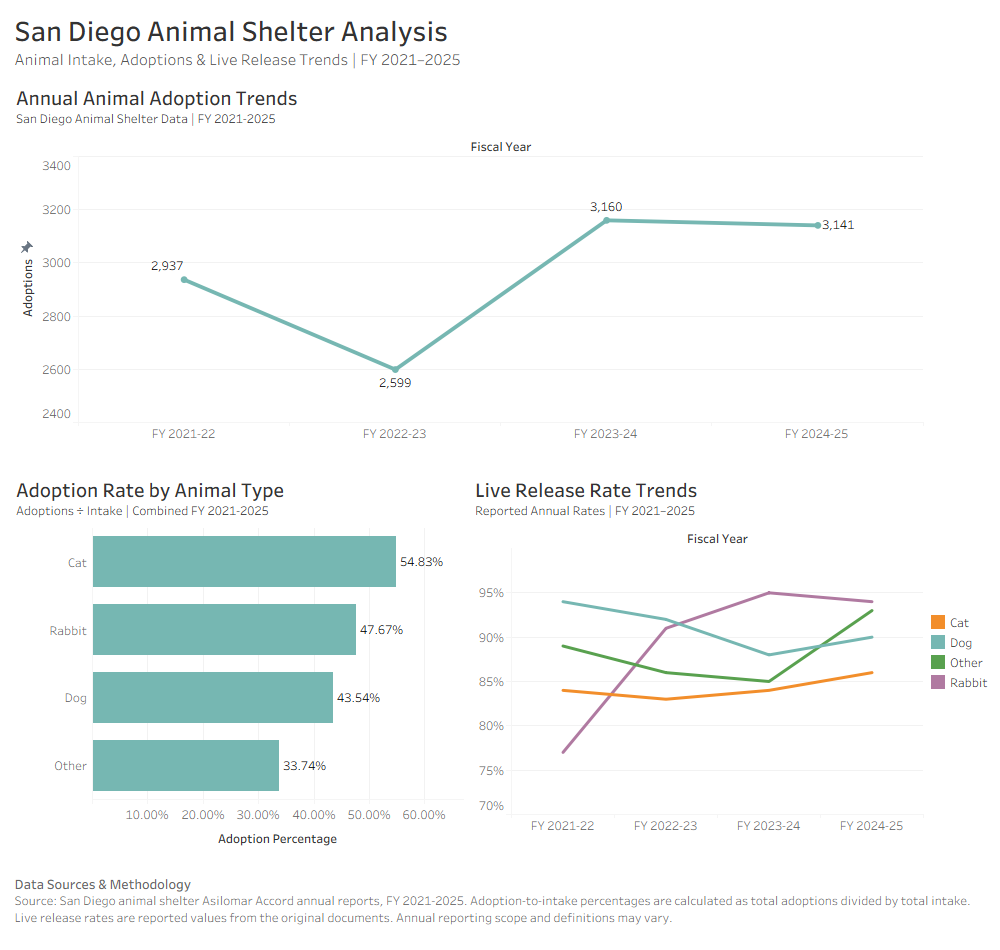

# San Diego Animal Shelter Analysis

### SQL Data Analysis Portfolio Project

## Project Overview

This project explores animal shelter intake and outcomes reported in San Diego animal services' annual Asilomar Accord statistics across four fiscal years, from FY 2021–2022 through FY 2024–2025.

Using Microsoft SQL Server, I analyzed adoption trends, euthanasia counts, and reported live release rates across four animal categories: dogs, cats, rabbits, and other animals.

The goal of this project is to identify patterns in shelter outcomes, compare trends across animal categories, and demonstrate practical SQL skills through real-world data analysis.


## Tableau Dashboard

This dashboard visualizes animal adoption trends, adoption-to-intake percentages, and reported live release rates across four fiscal years.



### Explore the Dashboard

[Download the Tableau Packaged Workbook](San_Diego_Animal_Shelter_Analysis.twbx)

The workbook contains three visualizations:
- **Annual Adoption Trends:** Total adoptions by fiscal year.
- **Adoption Rate by Animal Type:** Adoption-to-intake percentages for dogs, cats, rabbits, and other animals.
- **Live Release Rate Trends:** Reported live release rates by animal type and fiscal year.
  

## Tools & Technologies

- **Microsoft SQL Server / SSMS:** Data storage, querying, and analysis
- **Microsoft Excel:** Data preparation and CSV formatting
- **SQL:** Data aggregation, filtering, conditional logic, CTEs, and window functions

## Dataset

The dataset was manually compiled from four annual Asilomar Accord reports for San Diego animal services.

It contains 16 aggregated records covering four animal categories across four fiscal years.

The dataset includes:

- Fiscal year and animal category
- Total animal intake
- Adoptions
- Transfers out
- Animals returned to owners
- Euthanasia counts
- Animals that died or were lost
- Reported live release rates

**Data limitations:** The dataset contains annual aggregated statistics rather than individual animal records. Reporting organizations, coverage, and definitions may vary across fiscal years. Adoption-to-intake and euthanasia-to-intake percentages are descriptive ratios, not individual animal outcome probabilities.

## Research Questions

This project explores 13 research questions organized into four areas.

### Adoption Analysis
1. Which animal type had the highest number of adoptions?
2. How did total adoptions change across fiscal years?
3. How did cat and dog adoptions compare over time?
4. What was the adoption-to-intake percentage for each animal type?

### Euthanasia Analysis
5. How did reported euthanasia counts change over time?
6. Which animal types had the highest euthanasia counts?
7. What was the euthanasia-to-intake percentage for each animal type?

### Live Release Analysis
8. How can reported live release percentages be converted from text into numerical values?
9. How did reported live release rates compare between the first and last fiscal years?
10. Which animal types experienced the largest changes in reported live release rates?

### Advanced Trend Analysis
11. Which fiscal year had the highest adoption-to-intake percentage?
12. How did adoption totals change year over year?
13. What was the year-over-year percentage change in adoptions?

## Key Findings

### 1. Dogs accounted for the highest number of adoptions

Dogs had the highest total adoption count across the four fiscal years, with **6,440 adoptions**, followed by cats with **4,863**.

However, cats had a higher adoption-to-intake percentage (54.83%) than dogs (43.54%), demonstrating the importance of comparing proportions alongside raw counts.

### 2. Adoptions peaked in FY 2023–2024

The highest annual adoption total occurred in FY 2023–2024, with **3,160 adoptions**.

This represented a 21.59% increase compared with the previous fiscal year. Adoptions then decreased slightly to 3,141 in FY 2024–2025.

### 3. Reported euthanasia counts peaked in FY 2023–2024

Reported euthanasia counts increased from 493 in FY 2021–2022 to 798 in FY 2023–2024.

Counts subsequently decreased to 606 in FY 2024–2025, representing an approximately 24% reduction from the previous fiscal year.

### 4. Cats had the highest euthanasia-to-intake percentage

Cats had a euthanasia-to-intake percentage of **13.86%**, compared with 7.96% for dogs.

These figures represent aggregated reported outcomes relative to intake, not individual euthanasia probabilities.

### 5. Live release trends varied by animal category

Between FY 2021–2022 and FY 2024–2025:

- Rabbits: Increased by 17 percentage points (77% to 94%).
- Other animals: Increased by 4 percentage points (89% to 93%).
- Cats: Increased by 2 percentage points (84% to 86%).
- Dogs: Decreased by 4 percentage points (94% to 90%).

Rabbits showed the largest reported improvement, although their relatively small intake numbers warrant caution when interpreting this change.

## SQL Skills Demonstrated

- **Data retrieval:** `SELECT`, `WHERE`, `IN`
- **Aggregation:** `SUM()`, `COUNT()`, `GROUP BY`
- **Sorting:** `ORDER BY`, `ASC`, `DESC`
- **Data cleaning:** `REPLACE()`, `CAST()`
- **Calculated metrics:** `ROUND()`, `NULLIF()`, percentage calculations
- **Conditional aggregation:** `CASE WHEN`, `MAX()`
- **Common Table Expressions:** `WITH`
- **Window functions:** `LAG()`, `OVER()`
- **Trend analysis:** Year-over-year comparisons and percentage changes

## Data Sources

This project uses annual Asilomar Accord animal shelter statistics reported for San Diego animal services across four fiscal years:

- **FY 2021–2022:** SDAWC FY 21-22 https://www.sandiegocounty.gov/content/dam/sdc/das/statistics/annual-asilomar-reports/FY21-22_SDAWC_DAS.pdf
- **FY 2022–2023:** DAS FY 2023 https://www.sandiegocounty.gov/content/dam/sdc/das/statistics/annual-asilomar-reports/FY22-23_SDAWC_DAS.pdf
- **FY 2023–2024:** DAS FY 2024 https://www.sandiegocounty.gov/content/dam/sdc/das/statistics/annual-asilomar-reports/FY23-24%20SDAWC_DAS.pdf
- **FY 2024–2025:** SDAWC FY 2025 https://www.sandiegocounty.gov/content/dam/sdc/das/statistics/annual-asilomar-reports/FY%2024-25%20SDAWC_DAS.pdf

The data was manually extracted from the annual reports and organized into a structured dataset for SQL analysis.

The reports contain aggregated animal intake and outcome statistics. Reporting scope and terminology may differ between fiscal years, so results should not automatically be interpreted as countywide totals.

## Data Preparation & Methodology

### 1. Data Collection

Collected annual animal intake and outcome statistics for dogs, cats, rabbits, and other animals from four fiscal-year reports.

### 2. Data Preparation

Used Microsoft Excel to organize the reported statistics into a consistent table containing 16 records and nine columns.

Exported the cleaned dataset as a CSV file for import into Microsoft SQL Server.

### 3. Database Setup

Created a SQL Server database named `SanDiegoAnimalShelter` and imported the CSV data into a table named `AnimalShelterData` using SQL Server Management Studio.

### 4. SQL Analysis

Developed 13 SQL queries to examine adoption patterns, euthanasia counts, live release rates, and year-over-year trends.

Applied SQL techniques including aggregation, filtering, conditional expressions, data type conversion, Common Table Expressions, and window functions.

### 5. Analytical Limitations

- The dataset contains aggregated annual statistics rather than individual animal records.
- Adoption-to-intake and euthanasia-to-intake percentages are descriptive ratios rather than individual outcome probabilities.
- Reported live release rates were retained from the source reports rather than independently recalculated.
- Changes in reporting scope, organizational coverage, or definitions may affect comparisons between fiscal years.
- Findings describe the included reports and should not be generalized to all San Diego County shelters without additional verification.

## How to Run This Project

### Requirements

- Microsoft SQL Server
- SQL Server Management Studio (SSMS)
- The CSV dataset and SQL scripts included in this repository

### Setup Instructions

**1. Download the repository**

Download or clone this repository to your computer.

**2. Create the database**

Open `00_database_setup.sql` in SSMS and execute the database creation section.

This creates the `SanDiegoAnimalShelter` database if it does not already exist.

**3. Import the dataset**

In SSMS:

1. Right-click the `SanDiegoAnimalShelter` database in Object Explorer.
2. Select **Tasks → Import Flat File**.
3. Select `san_diego_animal_shelter.csv`.
4. Confirm that the first row is recognized as column headers.
5. Set the destination table name to `AnimalShelterData`.
6. Verify that numeric columns use `INT` and text columns use `VARCHAR`.
7. Complete the import.

**Important:** The Import Flat File Wizard creates the destination table. For a fresh installation, skip the `CREATE TABLE` section of `00_database_setup.sql` and allow the wizard to create and populate the table instead.

**4. Verify the import**

Run the following SQL query:

```sql
USE SanDiegoAnimalShelter;

SELECT COUNT(*) AS TotalRecords
FROM dbo.AnimalShelterData;
```

The expected result is **16 records**.

**5. Run the analysis**

Open `01_adoption_analysis.sql` in SSMS.

Select the `SanDiegoAnimalShelter` database and execute the individual SQL queries to explore the research questions and reproduce the findings.

## Project Files

| File | Description |
|---|---|
| `00_database_setup.sql` | Database creation, table schema, and import instructions |
| `01_adoption_analysis.sql` | SQL queries covering 13 research questions |
| `san_diego_animal_shelter.csv` | Cleaned dataset compiled from annual shelter reports |
| `README.md` | Project overview, methodology, findings, and setup instructions |
